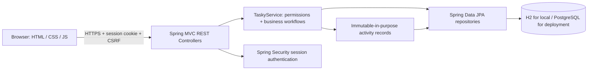
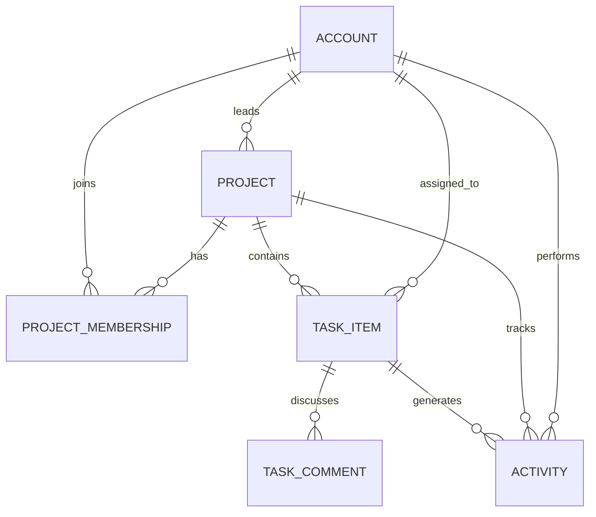

# Tasky — architecture and design decisions

## Application boundaries

Tasky is a **single deployable web application**. Spring Boot serves static assets, JSON APIs, and the login page at the same origin. This avoids cross-origin cookie/token pitfalls and keeps development simple. The Java API is organized by responsibility even though the initial implementation uses one transactional `TaskyService` for compactness.

## Relational model

### Entities
**Account:** `id`, `name`, unique `email`, BCrypt password hash, role, title, avatar color, enabled flag, creation date.

**Project:** `id`, unique short `projectKey`, name, description, status, accent color, start date, target date, lead ID, created date.

**ProjectMembership:** one row per `(project, account)` pair, plus Lead/Contributor role.

**TaskItem:** `id`, unique human-readable key (`PROJ-101`), project, title, description, status, priority, category, deadline, assignee, creator, order position, optimistic-lock `version`, timestamps.

**TaskComment:** task, author, message body and created timestamp.

**Activity:** actor, project, optional task, event type, message, timestamp. Activity events provide a readable history for task and project workflows. Current implementation permits deletion of a task while retaining its project-level deletion record.

## Backend request lifecycle
1. Spring Security authenticates requests with a cookie-backed session.
2. Spring MVC routes JSON to the controller and service.
3. `TaskyService` validates required fields, allowed enums, and project membership or elevated role.
4. JPA persists task, project, membership, or comment updates in a transaction.
5. Activity records are inserted for meaningful changes in the same transaction.
6. Frontend refreshes the authorized snapshot and rerenders the affected workspace view.

## Notable safeguards
- Authorization decisions occur **in Java**, not only in frontend controls.
- Task assignees must belong to the task's project. Disabled users cannot be assigned and existing assignments are cleared when an account is disabled.
- Administrators cannot remove their own admin role or deactivate their own account.
- Removing project membership unassigns that user's active project task references.
- User passwords are stored with BCrypt, not plaintext.
- All state-changing Spring API requests use session CSRF tokens.
- API models map database objects to safe JSON structures without exposing password hashes.
- Frontend interpolated strings are HTML-escaped and CSV exports escape leading spreadsheet formulas.
- JPA task rows contain a version field for optimistic locking during concurrent updates.

## Design system
- **Product name:** tasky. (independent branding)
- **Base canvas:** white; sidebar and Kanban columns use cool off-white surfaces
- **Primary:** indigo/violet `#6257EC`; selected navigation `#EDEBFF`
- **Status encoding:** To Do gray; In Progress violet; Review amber; Done mint
- **Typography:** Plus Jakarta Sans for display and DM Sans for body, with system-font fallbacks
- **Spacing:** 4/8/12/16/24/32 scale, restrained shadows, consistent 8–14px corner radius
- **Page hierarchy:** anchored sidebar → top navigation → breadcrumbs → page header → workflow tabs → action/filter toolbar → content
- **Interaction:** draggable Kanban cards, focused detail dialog, keyboard shortcuts, expandable person responsibility views, responsive mobile navigation

## MVP scalability boundaries
Current bootstrap loads the accessible project/tasks/activity dataset (capped activity events) and computes report metrics in the browser. For tens of thousands of tasks, replace it with paginated query endpoints, server-side aggregate queries, indexed full-text search, and asynchronous event notifications. Projects/teams are currently housed in a single workspace rather than separate tenant databases.
